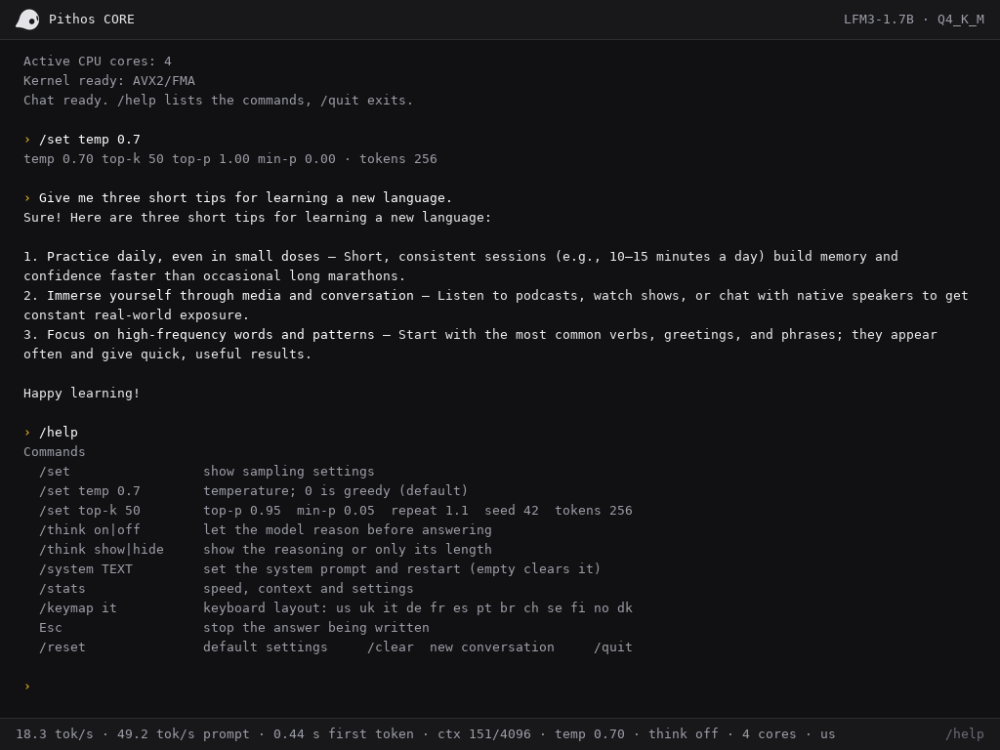
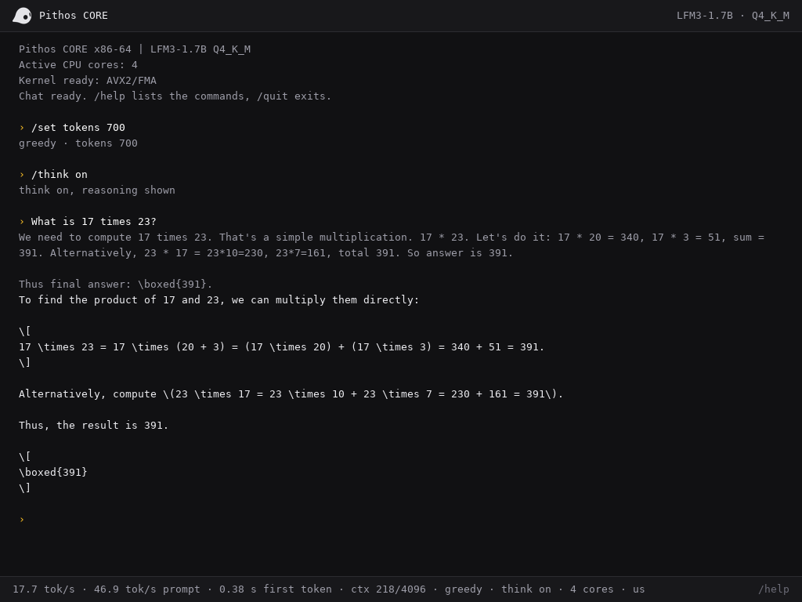

# LFM3-1.7B: runtime and reference

This directory holds the support for LiquidAI LFM3-1.7B in Q4_K_M GGUF format: the assembly runtime, as a Linux executable (`lfm3-next`) and as the standalone Pithos CORE kernel, the numerical reference and the verifications. The runtime shares the platform, threads, tokenizer, chat, engine and console with the LFM2.5 runtime.

[Italiano](README.it.md)

## Build and usage

The build needs the same tools as the main build, the GGUF and the official tokenizer files. On CPUs without AVX2, FMA and F16C the program stops with a message.

~~~sh
make lfm3 LFM3_MODEL=LFM3-1.7B-Q4_K_M.gguf LFM3_TOKENIZER=/opt/lfm3-ref/tokenizer.json
./build/lfm3/lfm3-next LFM3-1.7B-Q4_K_M.gguf --text 128 "Write two sentences about Turin."
./build/lfm3/lfm3-next LFM3-1.7B-Q4_K_M.gguf --chat 256
~~~

The options are those of `lfm-next`: `--generate`, `--text`, `--chat`, `--encode`, `--decode`, `LFM_CONTEXT` and `LFM_THREADS`. IDs range from 0 to 127,999. `build/lfm3/tokenizer.bin`, 12,519,600 bytes, must stay next to the executable. The prompt follows the official template with `enable_thinking=False`, which ends with an empty reasoning block `<think></think>`; earlier chat turns keep it as well, as in the template.

The matrix-vector products and attention are distributed among the workers, and the prompt is processed in blocks of 15 tokens. Logits, generation and chat transcripts are bitwise identical between 1 and 16 threads and between block and token-by-token prefill.

Measured on 27 November 2026 on an Intel Core i5-10500H, WSL2 with four visible CPUs, a 465-token prompt and 64 generated tokens, medians of three repetitions. The first-token time includes process start-up.

| Threads | First token | Prompt | Generation |
| --- | --- | --- | --- |
| 1, token by token | 38.04 s | 12 tokens/s | 9.91 tokens/s |
| 1 | 19.67 s | 24 tokens/s | 9.79 tokens/s |
| 2 | 11.82 s | 39 tokens/s | 16.37 tokens/s |
| 4 | 7.95 s | 59 tokens/s | 17.77 tokens/s |

On the same machine pithos on Windows, with `-t 4`, processed the same prompt at 55.7-61.9 tokens/s, start-up excluded, and generated 19.0-21.4 tokens/s; with six threads 67-68 and 22 tokens/s. Generation is limited by memory bandwidth: each token reads about 1 GB of weights.

## Pithos CORE: the standalone kernel

The same runtime builds as a Multiboot kernel, Pithos CORE, with the platform, processor start-up and console of the standalone kernel. The boot module holds the GGUF and the tokenizer tables without conversion, 1,112,152,240 bytes.

~~~sh
make lfm3-os LFM3_MODEL=LFM3-1.7B-Q4_K_M.gguf LFM3_TOKENIZER=/opt/lfm3-ref/tokenizer.json
python3 os/run.py --kernel build/lfm3/lfm3-os.elf build/lfm3/lfm3-boot.bundle --cpus 4 --threads 4
make lfm3-os-image LFM3_MODEL=LFM3-1.7B-Q4_K_M.gguf LFM3_TOKENIZER=/opt/lfm3-ref/tokenizer.json
python3 os/run.py --iso build/lfm3/pithos-core.iso --cpus 4 --display gtk
~~~

The `build/lfm3/pithos-core.iso` image starts the chat with 1,024 tokens per answer, an 8,192-position context and at most six processors. With 2 GiB of RAM about 0.9 GiB remains for the cache, about 20,000 positions; a 32,768-position context needs 3 GiB. Besides AVX2 and FMA, secondary processors must support F16C; those that do not stay parked.

`make verify-lfm3-os` compares the kernel in QEMU/KVM with the Linux executable: the bundle preserves GGUF and tables, five greedy sequences and three text answers match, the 64-token sequence matches on 2, 3, 4 and 6 active processors, and all 128,000 logits are bitwise identical on 1 and 4 processors. It also checks the serial chat with history, backspace, invalid input and `/clear`, the exact cache capacity, the refusal of CPUs without AVX2, F16C or XSAVE, invalid options, a missing or corrupt module and insufficient RAM.

### Console and options

With a framebuffer, that is when booting from the ISO, Pithos CORE shows a minimal interface in the palette of the pithos web interface: a header with the 24-pixel Pithos mark, the name and the model, the conversation with word wrapping, and a status line with generation speed, prompt speed, time to first token, context used, decoding, reasoning, processors and keyboard layout. User messages start with an amber mark, notices are dimmed, and markdown `**bold**` appears in bright white without asterisks. The serial port receives the same text with the same ANSI colour sequences. Without a framebuffer, in QEMU direct boot, the VGA text console remains.

The glyphs are generated at build time by `os/ui_font.py`: antialiased DejaVu Sans Mono for Latin, Greek, Cyrillic and symbols, GNU Unifont for the rest of the Basic Multilingual Plane, including Chinese, Japanese and Korean on two cells, and Noto Color Emoji in colour, reduced to 16x16. The file takes 3.5 MB and also holds the mark. Composed emoji sequences show as separate components, and Arabic and Indic scripts appear without ligatures and, for Arabic, left to right. The licenses are in `os/FONT-LICENSE.txt` and `os/CONSOLE-FONTS-LICENSE.txt`, also copied into the image.

The keyboard follows thirteen layouts generated from the XKB data with `ckbcomp` (`os/keymaps.py`, `make keymaps`): us, uk, it, de, fr, es, pt, br, ch, se, fi, no and dk, with Shift, AltGr, Caps Lock and dead keys. The layout is selected at boot with `keymap=it`, in the image with `make lfm3-os-image OS_KEYMAP=it`, or during the chat with `/keymap it`. In QEMU the characters produced by it, fr, de, es, uk, pt, se, ch and us were verified, including dead keys, AltGr, `ß`, `ñ`, `å` and `£`.

The chat commands also work in the Linux executable:

| Command | Effect |
| --- | --- |
| `/set temp 0.7` | sampling with a temperature; 0 is the default greedy decoding |
| `/set top-k 50`, `top-p 0.95`, `min-p 0.05`, `repeat 1.1`, `seed 42`, `tokens 2048` | candidate filters, repetition penalty, seed and maximum tokens per answer, up to the context |
| `/think on`, `/think off` | `<think>` reasoning before the answer |
| `/think show`, `/think hide` | reasoning shown dim or summarised by its token count |
| `/system TEXT` | system prompt; restarts the conversation |
| `/stats`, `/set`, `/reset`, `/help` | statistics, settings, defaults, help |
| `/keymap it` | keyboard layout, Pithos CORE only |
| Esc | clears the line being typed or stops the answer, Pithos CORE only |

Sampling follows the order of llama.cpp: repetition penalty over the last 64 tokens, the best `top-k` candidates, softmax with temperature, `min-p` relative to the best candidate, `top-p` and a draw from xorshift64*. With the same seed the answers repeat exactly, and with `top-k 1` they match greedy decoding. With the default settings, logits, generation and chat answers stay bitwise identical to the previous version. Reasoning stays in the conversation context, whereas the official template removes it from past turns.

## Implementation

- `layout.py` reads the GGUF at build time, checks the metadata, shapes and types of all 287 tensors and emits the offsets, types and layer sequence taken from the checkpoint. The executable checks an FNV-1a hash of the GGUF header, 8,247,328 bytes, at start-up.
- Every matrix input is quantized once to Q8_K: blocks of 256 values with a 127 / max |x| scale and round-half-to-even. The products with the Q4_K and Q6_K rows are integer, with `vpmaddubsw` and `vpmaddwd`, followed by one FMA per block, as in the AVX2 kernels of pithos and ggml. The shared Q6_K embedding provides both the input row, dequantized in ggml's order, and the 128,000 logits.
- RMSNorm uses F32 weights, the convolution keeps six history samples per channel, and the sandwich norm normalizes the output of every block before the residual.
- Attention computes the norm and RoPE per head, with the FP32 frequencies generated from `modeling_lfm3.py` in `frequencies.inc`; full-attention layers rotate the first 32 pairs. Each head reads KV head h / 4, sliding-window layers the last 256 positions, and the output is multiplied by the head's sigmoid gate. The FP32 KV cache takes 44 KiB per position.
- The workers receive whole matrix rows, or whole attention heads with their own score row, through the `job_entry` mechanism shared with LFM2.5. In the block prefill each Q4_K or Q6_K weight block is unpacked once and reused for every token; for each (row, token) pair the integer sums, the per-block FMA and the final reductions are those of the single-token kernel. Norms, convolution, RoPE and attention advance one token at a time, and the keys and values of the block are written to the cache before attention. The diagnostic `lfm3-layers` build processes the prompt token by token to keep the order of the dumps.
- `build_tokenizer.py` accepts `--vocab` and `--hash-bits` and, for tokenizers with `ignore_merges`, adds a table from byte sequences to IDs; `tokenizer.asm` looks up the whole piece first. With the default values the LFM2.5 tables stay byte-identical.

## Verification

~~~sh
make verify-lfm3-tokenizer LFM3_TOKENIZER=/opt/lfm3-ref/tokenizer.json
make verify-lfm3 LFM3_MODEL=LFM3-1.7B-Q4_K_M.gguf LFM3_TOKENIZER=/opt/lfm3-ref/tokenizer.json LFM3_REF=/opt/lfm3-ref
~~~

The tokenizer matches the official one on 62 texts, including Italian, Chinese, Japanese, Korean, Arabic, Hindi, Thai, emoji, code and special tokens, and in decoding all 128,000 IDs in groups of 2,000.

A bitwise comparison of the model is not possible. Q8_K rounding is discontinuous: a value on the boundary between two levels moves by a whole step for a one-ulp difference upstream, and such cases grow through the 24 layers, up to about one logit in the final logits. This applies to any engine with Q8_K activations, ggml and pithos included. `verify.py` therefore checks three things.

- Block replay: the diagnostic `lfm3-layers` build writes the embedding and the normalized output of every block for every token. Each reference block, with the same Q8_K inputs, runs on the runtime's states for all tokens, with the causal and sliding-window masks and the RoPE of the official forward pass, and must reproduce the runtime's output. A rounding flip stays local, to one token or to the tokens that read the changed key and value; a defect would affect most tokens. The median of every block must stay within 1e-5 relative, and the share of (token, block) pairs above that level is compared with that of the reference against itself when its inputs move by one ulp.
- FP32 reference: the argmax of the final logits must match.
- Generation: after a 463-token prompt, every greedy token must be the FP32 reference argmax, except at near ties within 0.25 logits.

Results of 26 November 2026:

| Check | Result |
| --- | --- |
| Replay, 20 tokens x 48 blocks | worst median 1.2e-6; 3.23% of pairs above 1e-5, against 3.85% for the reference with itself |
| Replay, 463 tokens x 48 blocks | worst median 1.6e-6; 4.72% above 1e-5, against 8.75% |
| Negative control: 255-position window | median 9.3e-5 in sliding-window layer 12: rejected |
| FP32 argmax, prompts of 1, 20, 463 and 721 tokens | 4 of 4; largest logit difference between 0.20 and 1.48 |
| Greedy generation, 96 tokens | 95 reference argmax; the only miss is a near tie of 0.018 logits |

With a single token, every block matches the reference within 1e-7 to 1e-6 relative, except two MLPs with a boundary rounding at 3e-5. The answer to `What is the capital of France?` matches the reference and pithos token for token.

With the official template the Q4_K_M model sometimes closes a reasoning block that does not exist and repeats the answer, for example `Il colore azzurro.</think>Il colore azzurro.`; all 14 tokens are the FP32 reference argmax, so the behaviour belongs to the model. The engine treats a `</think>` outside reasoning as the end of the answer, and the repetition is not written. The chat writes answers on stdout and labels on stderr. When the two streams are read from separate pipes, as a remote terminal or a tool that reassembles them in chunks does, a status message can land between the bytes of a UTF-8 character and appear as U+FFFD. With the same input and the streams in files, separate or merged, the output is valid UTF-8 without replacement characters.

## FP32 reference

`reference.py` builds the official `Lfm3ForCausalLM` architecture from the `modeling_lfm3.py` code of the Hugging Face repository without allocating its weights. Every `Linear` and the embedding dequantize their GGUF tensor when called, with the dequantizers of llama.cpp's `gguf` package, so only one matrix is resident at a time and the model runs in about 2 GiB. Norms and convolution taps are already F32 in the GGUF. The computation is FP32 with eager attention.

On loading, the script checks that the GGUF metadata match `config.json`: layers, dimensions, heads, window, RoPE bases, convolution kernel, special tokens and the equivalence between `rope_freqs` and partial rotation. It also checks that all 287 tensors are assigned and that no parameter is left without weights.

~~~sh
hf download LiquidAI/LFM3-1.7B config.json configuration_lfm3.py modeling_lfm3.py lfm3_conv.py tokenizer.json tokenizer_config.json chat_template.jinja special_tokens_map.json generation_config.json --local-dir /opt/lfm3-ref
python lfm3/reference.py MODEL.gguf /opt/lfm3-ref check
python lfm3/reference.py MODEL.gguf /opt/lfm3-ref logits out.f32 ID ...
python lfm3/reference.py MODEL.gguf /opt/lfm3-ref teacher P ID ...
~~~

It needs PyTorch, Transformers 5, `gguf` and `accelerate`. Each pass dequantizes the whole checkpoint, about 15-20 seconds on this machine, so token-by-token generation is slow. `teacher` instead checks another engine's output in a single pass: the first P IDs are the prompt, the rest its greedy continuation, and every continuation token must be the reference argmax. For misses it prints the logit distance from the maximum.

## Reference checks

- The GGUF matches `config.json` and all tensors map onto the official architecture.
- The official tokenizer and pithos produce the same 20 IDs for the test prompt.
- With `What is the capital of France?` and reasoning off, the reference and pithos generate the same nine tokens, EOS included: `The capital of France is **Paris**.`
- With a 465-token Italian prompt, beyond the 256-position window, 89 of the 92 tokens generated by pithos are the reference argmax. The three misses are near ties, at distances of 0.215, 0.087 and 0.008 logits, consistent with the Q8_K quantization of activations and the FP16 cache of pithos.

pithos was run with `--cpu --no-cache --reasoning off --temp 0 --repeat-penalty 1.0 --ids`. Its prompt without reasoning ends with `<think>\n</think>\n`, whereas the official template with `enable_thinking=False` produces `<think></think>`; the comparisons use the same text for both engines.

## Differences from LFM2.5-350M

| | LFM2.5-350M | LFM3-1.7B |
| --- | --- | --- |
| Layers | 16: 10 convolution, 6 attention | 24: 13 convolution, 6 full attention, 5 with a 256-position window |
| Width and MLP | 1024, 4608 | 2048, 7680 |
| Heads | 16 query, 8 KV, dimension 64 | 16 query, 4 KV, dimension 128 |
| Convolution | 3 taps | 7 taps, six history samples |
| Weights | BF16, 709 MB | Q4_K and Q6_K, 1.1 GB; shared Q6_K embedding |
| Vocabulary | 65,536 | 128,000 rows, IDs used up to 125,032 |

New components, all present in the official code:

- sandwich norm: one RMSNorm on the output of the convolution or attention block and one on the output of the MLP, before each residual;
- a per-head gate: `sigmoid(gate_proj(x))`, computed from the normalized attention input, multiplies the head's output;
- in full-attention layers RoPE rotates only the first 32 pairs, with base 1e6 and the frequencies of the full dimension; the other 32 stay fixed. Sliding-window layers rotate all 64 pairs with base 1e4. The pairs are (i, i+64), as in LFM2.5;
- in sliding-window layers each token sees the last 256 positions, its own included;
- the template starts `<think>` reasoning by default.

## Tokenizer

The pre-tokenization regex is the same as LFM2's, so the Unicode splitting of `tokenizer.asm` still applies. Four aspects change:

- `ignore_merges` is enabled: a piece found whole in the vocabulary is emitted directly, without merges. This needs a table from byte sequences to IDs;
- there are 293,320 merges, more than the former hash table of 131,072 slots;
- IDs exceed 65,535;
- the longest token takes 386 bytes, more than the former 128-byte decoding buffer.

## Quantized kernels

The pithos C engine (`src/quant_avx2.c`) is the reference for the kernels. The activations of each row are quantized to Q8_K: blocks of 256 int8 values with one scale and sixteen partial sums. The Q4_K and Q6_K products are integer, with `vpmaddubsw` and `vpmaddwd`, and a single floating-point FMA per block. The corrections for the Q4_K minimums and the Q6_K -32 offset use the partial sums. The multi-token variants unpack each weight block once and reuse it for every token, like the block prefill.

## Memory

With an FP32 KV cache, the 11 attention layers take 44 KiB per position; a 256-position ring for the five sliding-window layers would bring this down to about 24 KiB. The 1.1 GB checkpoint fits the RAM below 4 GiB used by the standalone kernel.
